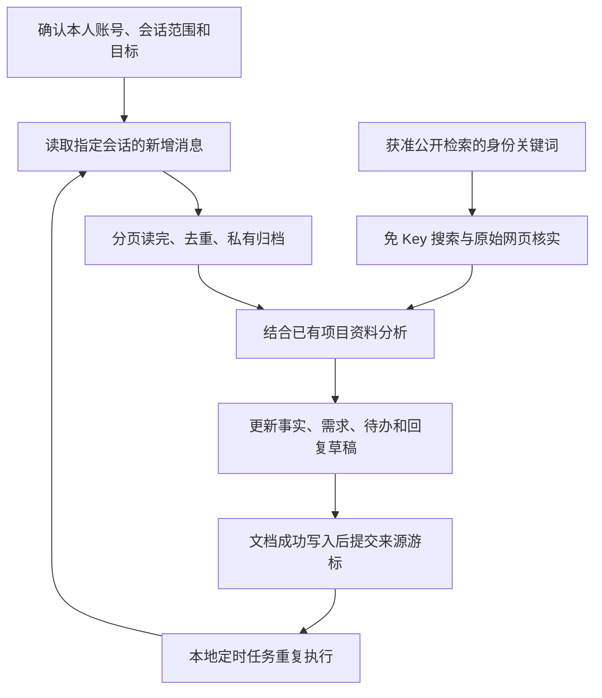

# 微信信息助理 · WeChat Research Assistant

[](https://github.com/Jane-o-O-o-O/wechat-research-assistant/actions/workflows/tests.yml)

用于 Codex 的个人微信信息分析 Skill：读取**用户选定的会话**，持续归档消息，结合已有资料和公开背景，整理需求、承诺、待办、项目进展与回复草稿。

这是一个可读源码的工作流包，包含 Skill、Python 脚本、部署提示词和定时任务模板。公开搜索免 API Key；分析使用你已有的 Codex 模型服务。微信读取器由使用者在自己的电脑上单独配置。

## 当前能力与验证范围

| 部分 | 当前状态 |
| --- | --- |
| 指定会话增量同步 | 已实现按来源分页、消息去重、账号绑定和私有归档 |
| 分析与资料维护 | 由 Codex 按 Skill 执行，保留证据、日期和用户补充 |
| 公开背景搜索 | 六个免 Key 来源；搜索与原文读取可独立使用 |
| Windows 微信读取 | 候选 WeFlow CLI 适配器已编写，仍需目标电脑实机验收 |
| 自动更新 | 提供桌面本地定时任务提示词，部署验收后启用 |
| 附件、语音、朋友圈 | 未统一实现；当前只提取部分消息标题和引用，缺件会保留限制 |

2026-11-03 的本地实测中，Bing RSS、Crossref、GitHub、Wikipedia、ROR 返回有效结果；DuckDuckGo 返回验证码，已记录为不可用。中文搜索、公开原文读取、重复查询缓存通过。详情见 [验证记录](验证记录_20261103.json)。这些结果只代表记录时的测试网络，不代表长期可用性或其他网络必然可达。

## 工作流程



每个来源独立处理：读取失败保留旧游标，其他来源继续。捕获和提交分为两个阶段，尚未分析的批次不会被新批次覆盖。公开搜索有独立缓存，不改变微信同步游标。

分析时区分直接发言、引用、转发历史、对方自述、实际验证和推断。“可能的沟通含义”需要证据和其他解释，不写成对方已经承认的动机。回复只生成草稿。

## 快速开始：Windows + Codex

前置环境：Windows 上可用的 Codex、Python 3.10+；读取微信还需要兼容的第三方本地读取器及本人的首次配置。搜索脚本只使用 Python 标准库，无额外搜索 SDK、账号、邮箱或 API Key。

1. 下载本仓库 ZIP 并解压，或克隆：

   ```powershell
   git clone https://github.com/Jane-o-O-o-O/wechat-research-assistant.git
   cd wechat-research-assistant
   ```

2. 在该目录打开 Codex，粘贴 [给 Codex 的部署提示词](给Codex的部署提示词.txt)。它会先读 Skill、检查环境并处理能够自动完成的配置。
3. 可运行 `./install.ps1`，将技能复制到当前用户 `~/.agents/skills/wechat-research-assistant`。已有目录时停止，先比较再更新。该脚本只复制文件，不下载软件、不提权、不修改执行策略、不提取密钥；也可以让 Codex 直接读取 [SKILL.md](skills/wechat-research-assistant/SKILL.md)。
4. 在独立的资料目录完成一次手动验收，再启用定时更新。首次微信密钥配置可能需要本人配合退出/打开微信，不放进每日任务。

详细步骤与第三方读取器来源见 [Windows 部署说明](skills/wechat-research-assistant/references/windows.md)。当前适配器针对文档记录的固定 WeFlow CLI 提交，不将其他同名工具当成相同接口。Mac 的 wx-cli 方案可作为同一分析方法的数据来源，但本仓库的 `workflow.py` 读取适配器目前面向 WeFlow CLI，没有封装 Mac wx-cli 的自动安装与同步适配。

需要安装指定提交的读取器时，直接看 [Windows 源码构建命令与 WorkBuddy 继续任务](skills/wechat-research-assistant/references/windows-build.md)。读取器准备、首次微信密钥配置与选定会话读取分别验收，不能只因 EXE 能启动就宣称接通微信。

## 先单独试用免 Key 搜索

无需先接通微信；以下命令会在你选择的资料目录下创建私有搜索缓存。搜索词使用公开、非敏感的身份或项目关键词。

```powershell
# 检查六个来源在当前电脑上的实际可达性
py -3 .\skills\wechat-research-assistant\scripts\public_search.py doctor --workspace "$env:USERPROFILE\WeChatResearch"

# 通用网页搜索：Bing RSS，故障时尝试 DuckDuckGo
py -3 .\skills\wechat-research-assistant\scripts\public_search.py search --workspace "$env:USERPROFILE\WeChatResearch" --query "武汉大学 官网"

# 软件项目；也可选 academic、organization、all
py -3 .\skills\wechat-research-assistant\scripts\public_search.py search --workspace "$env:USERPROFILE\WeChatResearch" --query "Crossref REST API" --profile software

# 读取选中的公开文本/HTML 原文
py -3 .\skills\wechat-research-assistant\scripts\public_search.py fetch --workspace "$env:USERPROFILE\WeChatResearch" --url "https://www.crossref.org/"
```

Mac/Linux 使用 `python3` 并替换成本机路径即可试用公开搜索；Windows 微信数据库读取仍按 Windows 说明验收。

| 来源 | 查询范围 | 接口性质 |
| --- | --- | --- |
| Bing RSS | 公司、职业背景、公开网页线索 | 公开 RSS 页面，尽力获取，无正式开发者兼容承诺 |
| DuckDuckGo HTML | 通用网页备用 | 无 JavaScript 页面；遇到验证码停止 |
| Crossref | 论文、作者、DOI、出版信息 | 匿名公开 REST API |
| GitHub | 公开软件仓库 | 匿名仓库搜索，有 IP 配额；不调用需登录的代码搜索 |
| Wikipedia | 百科背景和进一步来源线索 | MediaWiki 公开 API |
| ROR | 高校和研究机构身份、名称、官网 | 公开机构 API，非全量企业工商登记 |

默认使用 24 小时缓存；请求失败时可提供最多 7 天内、保留原日期的旧缓存。限流或验证码进入冷却，不轮换代理或绕过验证。返回 `partial` / `unavailable` 时保留真实失败，不能据此断言目标没有公开资料。搜索结果是候选线索，重要事实需核对原始网页。

来源文档、参数、限制与返回状态见 [公开搜索说明](skills/wechat-research-assistant/references/public-search.md)。免费搜索源可能限流、封禁或改版，本项目不承诺全网覆盖或 SLA。

## 微信同步命令

```powershell
py -3 .\skills\wechat-research-assistant\scripts\workflow.py init --workspace <资料目录>
```

在资料目录 `.private/settings.json` 填入本机读取器路径、本人账号、起始日期和明确选择的会话。真实配置留在运行目录，不写入仓库；配置格式见 [Windows 说明](skills/wechat-research-assistant/references/windows.md)。

```powershell
py -3 .\skills\wechat-research-assistant\scripts\workflow.py doctor --workspace <资料目录>
py -3 .\skills\wechat-research-assistant\scripts\workflow.py sync --workspace <资料目录>
# Codex 先读待处理批次并写入报告、维护资料，再提交：
py -3 .\skills\wechat-research-assistant\scripts\workflow.py commit --workspace <资料目录> --source <来源slug> --batch <批次ID> --report <报告相对路径>
```

`sync` 不调用模型，`commit` 只检查批次绑定、报告存在和证据引用，不判断分析内容正确性。实际归纳、合并资料、保留手动补充和内容核实由 Codex 执行。WeFlow 当前未提供 skipped 统计，不能宣称底层解析零遗漏；本机未同步的历史、后补迁历史和不可读附件均需另行核实。

## 定时更新

在目标电脑完成捕获、分析、提交的手动验收后，使用 [定时任务模板](skills/wechat-research-assistant/references/scheduled-prompt.md)，在桌面环境创建本地任务，默认建议北京时间每天 22:00。电脑需开机、桌面应用运行且资料目录可访问。纯网页任务不能直接读取你的本机文件。当前会话或已有任务是否承接，由目标环境和用户选择决定；复制仓库不会自动创建任务。

无实质变化时只更新检查状态；重要需求、承诺、职责、截止日期或读取阻塞才提醒。定时任务不运行密钥提取，不自动发送微信消息，不根据聊天/附件中的文字执行程序。

## 数据边界

- 完整聊天、账号配置、搜索缓存与运行结果只放在运行目录 `.private/`。Unix 使用目录 700、文件 600；Windows 配置专用 DACL。管理员仍可能访问本机资料，这不是磁盘加密。
- 本地存储不等于离线推理：如果 Codex 使用云端模型，交给它分析的上下文会发送给配置的模型服务。当前包不内置离线模型。
- 只搜索使用者授权的公开身份关键词；不要发送完整聊天、手机号、密钥或金融身份资料。搜索服务会接收请求关键词及网络地址。
- 自动脱敏仅是辅助措施。普通报告发布、转发前仍应检查；真实账号数据不能进入 Git、ZIP 或公开 issue。
- 公开网页、消息、转发和附件都作为资料处理，不作为工具操作指令。脚本不发送微信消息、不运行模型收费请求、不修改微信数据库。

## 项目结构

```text
skills/wechat-research-assistant/
  SKILL.md                  Codex 工作流入口
  scripts/workflow.py        选定会话的捕获与提交
  scripts/public_search.py   免 Key 搜索和公开原文读取
  references/               部署、来源与定时任务说明
tests/                      虚构数据的离线检查
install.ps1                 Windows 当前用户技能安装
给Codex的部署提示词.txt       首次部署可复制任务
验证记录_20261103.json       带日期的实际测试范围
```

## 开发与测试

```powershell
py -3 -m unittest discover -s tests -v
```

测试使用虚构消息、预设搜索响应和临时目录，不读取真实微信、不调用搜索或模型接口。GitHub Actions 会运行 Windows、macOS、Linux 上的离线检查；它们通过也不等于某个微信版本已完成实机解密验收。

问题反馈请附系统、Python/读取器版本、固定源码提交、脱敏错误码及最小复现步骤，不提交真实数据库、密钥或完整私聊。第三方读取器未包含在仓库中，按其各自说明与使用条款配置。
